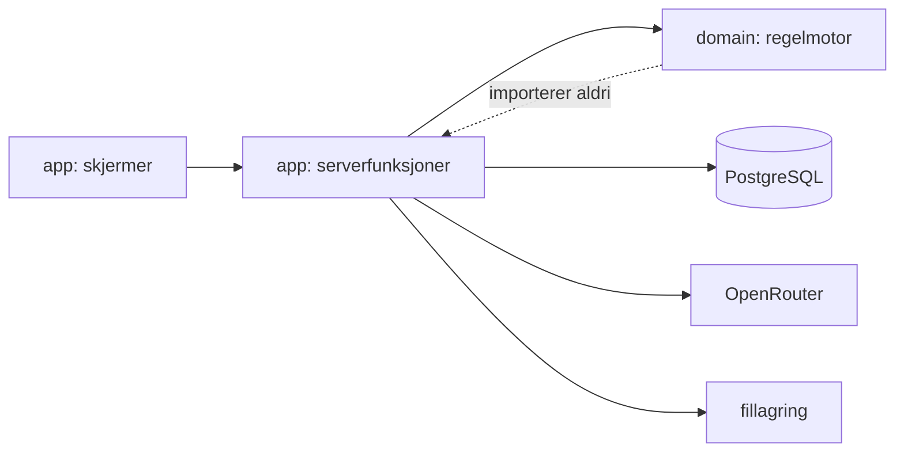
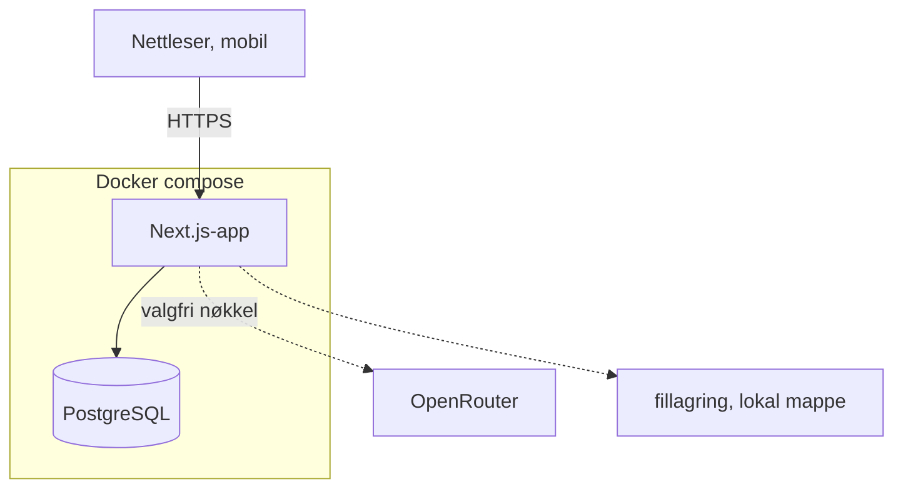
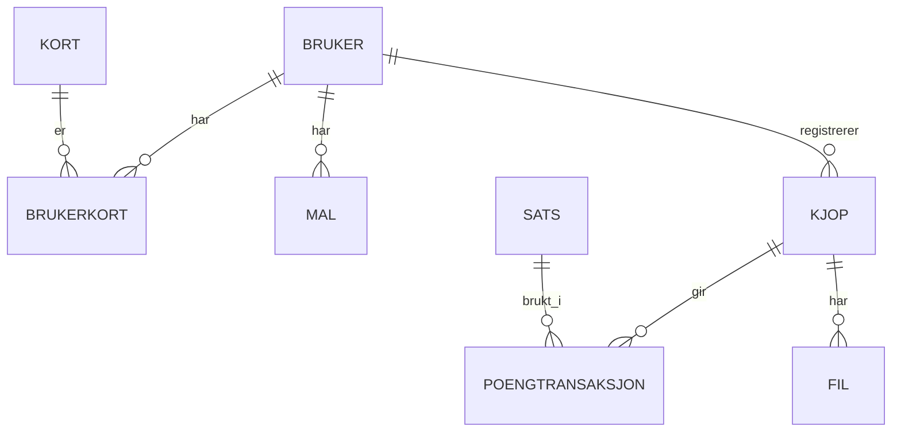

# Architecture Spine — EuroBonus Poeng-stacker

`[ASSUMPTION]` = foreslått av Claude, ikke eksplisitt godkjent av Anneli. `[ADOPTED]` = valgt av Anneli i coaching.

## Design Paradigm

**Lagdelt monolitt med ren kjerne.** Én Next.js-app i to soner:

- `src/domain/` er kjernen: regelmotor og anbefaling som rene funksjoner. Ingen database, nettverk, KI, miljøvariabler eller klokke (tid sendes inn).
- `src/app/` er skallet: skjermer, serverfunksjoner, database, innlogging, KI og fillagring. Skallet kaller kjernen. Kjernen kjenner ikke skallet.

## Invariants & Rules



### AD-1 — Én Next.js-app i TypeScript `[ADOPTED]`

- **Binds:** all
- **Prevents:** to språk eller to tjenester som må settes opp og holdes konsistente
- **Rule:** Frontend, server og regelmotor ligger i ett TypeScript-prosjekt. Ingen egen backend-tjeneste.

### AD-2 — Ren kjerne i `domain/` `[ADOPTED]`

- **Binds:** SK-1, NFR-3, NFR-8, FR-13, FR-14, FR-16, FR-21, FR-22–25
- **Prevents:** poengregler sammenvevd med database og KI, og dermed utestbare
- **Rule:** `src/domain/` importerer aldri fra `src/app/`, `prisma`, `fetch`, miljøvariabler eller `Date.now()`. Funksjonene tar sats, kjøp og tid som argument og returnerer verdier. All poengberegning og anbefaling skjer her. Lint-regel (import-restriksjon) håndhever det.

### AD-3 — PostgreSQL med Prisma `[ADOPTED]`

- **Binds:** all lagring, NFR-1, NFR-4
- **Prevents:** forskjellig databasetype lokalt og publisert; skjemaendringer utenfor migreringer
- **Rule:** Én PostgreSQL-database. Lokalt som tjeneste i `docker compose`, publisert som administrert Postgres. Datamodellen eies av `prisma/schema.prisma`; alle endringer går via Prisma-migreringer. Ingen SQLite.

### AD-4 — Satser og regler er data `[ADOPTED]`

- **Binds:** SK-5, FR-13–16, FR-15
- **Prevents:** satser hardkodet i kode; endring som krever kodeendring
- **Rule:** Satser lagres i tabellen `Sats` (kilde, poengtype, poeng per 100 kr, gyldig fra/til, kilde-URL, verifisert dato). `src/app/` leser aktive satser og sender dem som argument til `domain/`. Seed-fil fyller startsatsene. Ingen sats-tall i `domain/`.

### AD-5 — Beløp og poeng er heltall; avrunding ned ett sted `[ASSUMPTION]`

- **Binds:** FR-13, FR-14, FR-17, NFR-8, SK-1
- **Prevents:** flyttallsfeil og ulik avrunding i to deler av appen, som kan overestimere poeng
- **Rule:** Beløp lagres som heltall i øre. Poeng og Trumf-poeng er heltall. All avrunding gjøres i `domain/`, alltid nedover. Ingen andre lag runder av eller regner poeng.

### AD-6 — Poengtransaksjoner er lagret fasit per kjøp og kilde `[ASSUMPTION]`

- **Binds:** FR-10, FR-11, FR-16, FR-17, FR-21
- **Prevents:** at lister, baren og tempo viser forskjellige tall, og at en satsendring skriver om gamle poeng i det skjulte
- **Rule:** Ved bekreftet lagring beregner `domain/` poeng, og `app/` lagrer én `Poengtransaksjon` per kjøp og kilde, med `sats_id` som ble brukt. Rediger og slett kjøp beregner transaksjonene for det kjøpet på nytt i samme databasetransaksjon. Hjem, listen og tempo summerer lagrede transaksjoner pluss brukerens startverdier (FR-4), aldri en ny beregning. Skillet mellom overført og ventende Trumf-poeng (200-grensen) regnes i `domain/` fra disse tallene.

### AD-7 — KI er server-side forslag, aldri fasit `[ADOPTED]`

- **Binds:** FR-7–9, NFR-2, SK-2, SK-3
- **Prevents:** nøkkellekkasje, lagring av uverifisert tolkning, krasj uten nøkkel
- **Rule:** Bare serveren kaller OpenRouter, med nøkkel fra miljøvariabel. Svaret valideres mot et skjema (beløp, butikk, kort, dato) og vises som forslag med usikre felt merket. Ingenting lagres før bruker bekrefter. Mangler nøkkel eller kallet feiler, vises skjemaet. Ingen funksjon unntatt fritekst avhenger av KI.

### AD-8 — Innlogging og eierskap `[ADOPTED]`

- **Binds:** FR-1, NFR-9
- **Prevents:** at en bruker ser en annens data
- **Rule:** Better Auth med e-post og passord, lagret i egen Postgres. Hver brukerdata-tabell har `bruker_id`; alle spørringer filtreres på innlogget bruker i `app/`. Kontosletting sletter brukerens data.

### AD-9 — Fillagring bak grensesnitt, ikke i databasen `[ADOPTED]`

- **Binds:** NFR-5
- **Prevents:** filer i databasen; bytte av lagringssted som krever omskriving
- **Rule:** Filer skrives via ett grensesnitt i `src/app/storage/`. Databasen lagrer bare referanse (sti, type, eier). V1 lagrer ingen filer; lokal mappe er standard.

### AD-10 — Konfigurasjon og hemmeligheter `[ADOPTED]`

- **Binds:** NFR-1, NFR-6, SK-4
- **Prevents:** hemmeligheter i repoet; at appen krasjer uten nøkkel
- **Rule:** All konfigurasjon går via miljøvariabler, lest ett sted (`src/app/config.ts`). `.env.example` har alle navn og ingen verdier. `.env` er i `.gitignore`. Manglende valgfri nøkkel gir en funksjon som er slått av, aldri en feil ved oppstart.

### AD-11 — Én kommando for å kjøre, én for å teste `[ADOPTED]`

- **Binds:** NFR-1, SK-1, SK-4
- **Prevents:** en app sensor ikke får startet
- **Rule:** `docker compose up` starter app og Postgres, kjører migreringer og seed (testbruker, kort, kjøp, satser). `npm test` kjører alle enhetstester uten nøkler og uten nettverk. Begge kommandoene står i README med forutsetninger.

### AD-12 — Sporbarhet fra krav til kode `[ASSUMPTION]`

- **Binds:** alt arbeid
- **Prevents:** at sensor ikke kan følge planen fra krav til kode
- **Rule:** Arbeid deles i små commits på en gren per historie. Commit-melding og PR-tittel nevner FR-/AD-ID. Tester navngis med kravet de dekker. Dokumentene i `_bmad-output/` holdes à jour når koden avviker.

## Consistency Conventions

| Concern | Convention |
| --- | --- |
| Naming | Norsk for domenebegreper og UI-tekst (`kjop`, `sats`, `poengtransaksjon` i datamodell og filnavn uten æøå). Engelsk for tekniske navn (`config`, `storage`). |
| Data & formats | ID-er er UUID. Datoer lagres som UTC-tidsstempel (kjøpsdato som dato). Beløp i øre (heltall). Poeng heltall. Norsk tallformat bare i visning. |
| State & cross-cutting | Skriving skjer i serverfunksjoner, i én databasetransaksjon. Feil returneres som `{ ok: false, feil }`, ikke kastet til UI. Ingen global klienttilstand utover skjema. |
| UI | Følger `DESIGN.md` (tokens) og `EXPERIENCE.md` (atferd). Ikke egne farger eller tekster utenfor dem. |

## Stack

| Name | Version |
| --- | --- |
| Next.js (App Router) | 16.x |
| React | 19.x |
| TypeScript | 5.x |
| Node.js | 22 LTS (Docker-bilde) |
| PostgreSQL | nyeste stabile major, pinnet i `docker-compose.yml` |
| Prisma | 7.x |
| Better Auth | nyeste stabile, pinnet i `package.json` |
| Vitest | 5.x |
| Playwright | 1.x (valgfritt, e2e) |

Eksakte versjoner pinnes ved oppsett med `npm`. Verifisert via nettsøk 2026-11-24 (Next.js 16.x, Better Auth anbefalt for nye prosjekter, Auth.js v5 fortsatt beta, Vitest 5.1, Playwright 1.65). Patch-nummer og PostgreSQL-major er ikke bekreftet.

## Structural Seed





```text
/
  src/
    domain/            # ren regelmotor og anbefaling (AD-2)
    app/               # sider, serverfunksjoner, config, storage, KI
  prisma/
    schema.prisma      # datamodell (AD-3)
    seed.ts            # satser, testbruker, eksempelkjøp (AD-4, AD-11)
  tests/               # Vitest mot testtabell
  docs/                # PRD, vedlegg, prosessdokumentasjon
  _bmad-output/        # planleggingsdokumenter
  docker-compose.yml
  .env.example
  README.md
```

Rotmappen holdes ryddig: ingen løse notater eller byggefiler.

## Capability → Architecture Map

| Capability / Area | Lives in | Governed by |
| --- | --- | --- |
| Oppsett og mål (FR-1–6) | `app/` sider + Prisma | AD-3, AD-8 |
| Registrere kjøp, skjema (FR-8, 10–12) | `app/` serverfunksjoner | AD-5, AD-6 |
| Registrere kjøp, fritekst (FR-7, 9) | `app/` KI-adapter | AD-7, AD-10 |
| Poengberegning (FR-13–16) | `domain/` | AD-2, AD-4, AD-5 |
| Fremdrift og mål (FR-17–21) | `domain/` + lagrede transaksjoner | AD-2, AD-6 |
| Anbefaling (FR-22–25) | `domain/` | AD-2, AD-4 |
| Kjøring og tester (NFR-1, SK-4) | compose, README | AD-10, AD-11 |
| Sporbarhet (sensor) | commits, tester, dokumenter | AD-12 |

## Deferred

- **Publisering:** valg av administrert Postgres (Neon eller Supabase som ren Postgres) og Vercel-oppsett. Avgjøres når kjernen kjører lokalt. Rammen er AD-3 og AD-10.
- **Ende-til-ende-tester (Playwright):** omfang avgjøres etter kjernen. Enhetstester mot testtabellen er påkrevd (AD-11).
- **CI (GitHub Actions):** avgjøres senere. Ikke påkrevd for v1.
- **Passordtilbakestilling og e-postbekreftelse:** ikke i v1.
- **Detaljert datamodell (kolonner og indekser):** eies av `schema.prisma`.
- **Companion Ticket, Fly Premium og tempo i detalj:** følger PRD (FR-19–21); detaljer avgjøres per historie.
- **Logging og overvåking:** ikke i v1.
- **Rate-begrensning og misbruksvern på KI-endepunktet:** avgjøres når fritekst bygges.
